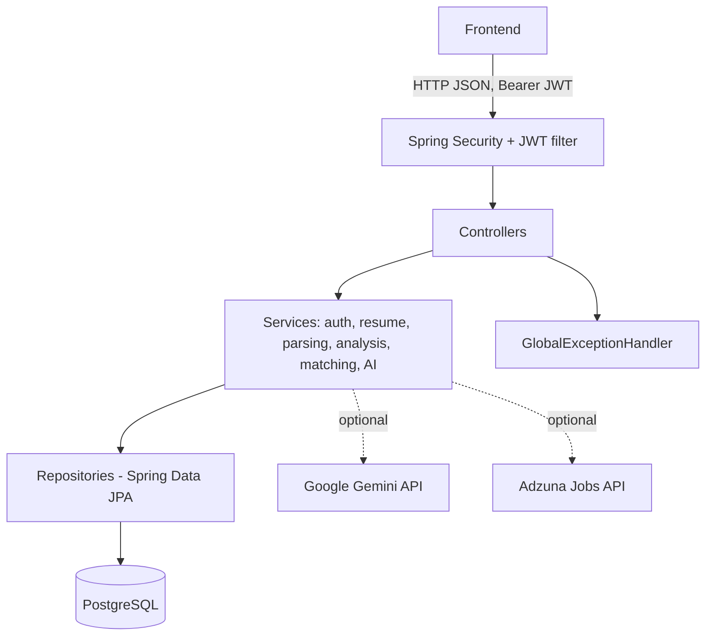
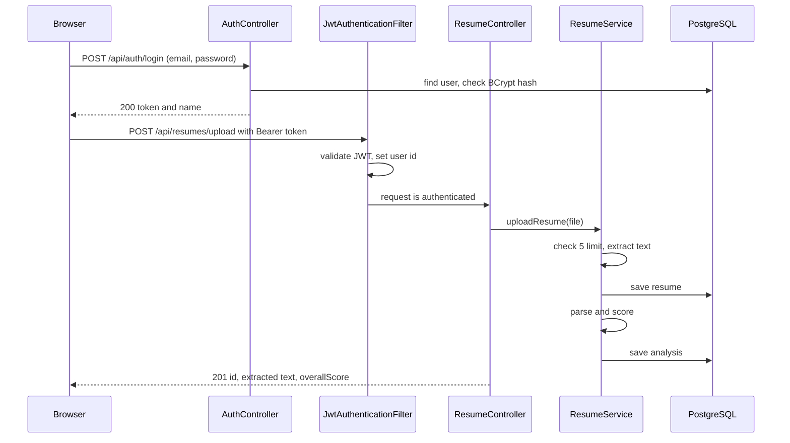
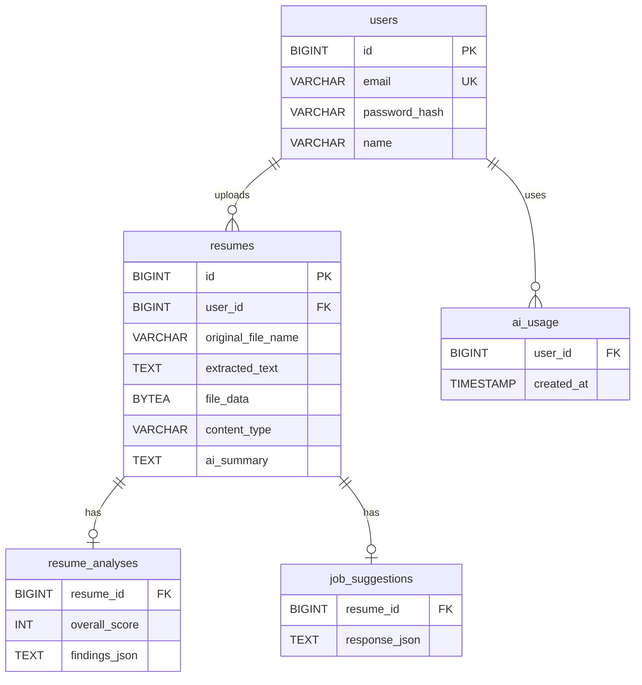

# Resqora

Resqora is a resume analysis web app. A user registers, uploads a resume (PDF or DOCX), and gets:

- the text extracted and split into sections (contact, skills, education, experience, projects, certifications)
- a rule-based score with findings on what is strong and what is missing
- a match score against a job description, listing matched and missing skills
- optional AI help through Google Gemini: a saved 2-3 line summary per resume and a short chat about the resume (optionally against a job description)

The backend is a simple layered Spring Boot monolith (REST API, JWT login, PostgreSQL). The frontend is a React single-page app in `resqora-frontend/`.

## Features

- Register with name, email and password (8+ chars, letters and digits); log in to get a JWT (BCrypt-hashed passwords); change your name, change your password, delete your account
- Login protection: too many failed logins per email or IP returns 429 for 15 minutes; password change and account delete share a lock of 5 wrong passwords per 15 minutes
- Upload PDF/DOCX resumes (max 2 MB, max 5 resumes per user), list them, preview the original file and delete them
- Text extraction (PDFBox, Apache POI) that reads multi-column PDFs (sidebar, 2 or 3 columns) column by column, and DOCX tables, nested tables and text boxes in order; scanned PDFs get a clear 422
- When a layout can't be read reliably, the analysis says so first instead of showing a confident-looking low score
- Demo mode: a ready-made demo account that is reset on every restart and can't be deleted or changed
- Rule-based parsing into structured sections, tolerant of heading variants ("Work History", "Tech Stack"), wrapped bullets and many date formats
- Rule-based scoring: overall, completeness, skills, projects, experience, education, plus findings that point to the exact line to fix
- Each resume is analysed right after upload and the result is saved, so scores show up on the dashboard immediately
- Job description matching against a ~200-skill dictionary in `skills.txt`, with aliases (no AI, deterministic)
- Job suggestions ranked by match score: currently need Adzuna keys and are hidden in the frontend; the job source is being replaced with a free one
- AI summary (saved per resume) and resume chat through Gemini, with a per-user daily limit and an app-wide daily cap
- Same JSON error format for every error, including 401 from Spring Security
- Swagger UI with a JWT "Authorize" button
- Each user can only see and change their own resumes (others' resumes return 404)

## Tech stack

| Layer | Technology |
|---|---|
| Language | Java 21 |
| Backend framework | Spring Boot 4.1.1 (Web MVC, Data JPA, Validation, Security) |
| Authentication | JWT (jjwt 0.12.6), BCrypt |
| Database | PostgreSQL, schema managed by Flyway (V1-V8) |
| ORM | JPA / Hibernate |
| Document parsing | Apache PDFBox 3.0.5, Apache POI 5.4.1 |
| API docs | springdoc-openapi 3.1.1 (Swagger UI) |
| AI (optional) | Google Gemini REST API via Spring RestClient |
| Job search (optional) | Adzuna Jobs API via Spring RestClient (being replaced) |
| Testing | JUnit 5, Mockito, Spring MockMvc, H2 in-memory database |
| Frontend | React 19, React Router 7, Vite 6, Tailwind CSS 4, docx-preview |
| Build | Maven wrapper, npm |

## Development method

The project follows the **Iterative and Incremental** model. Every increment is a small, working, tested slice of the system that was committed on its own:

1. Core: register/login with JWT, resume upload, text extraction, parsing and rule-based scoring
2. CORS for the frontend, Swagger UI, proper status codes and one error format, stateless sessions
3. List and delete resumes, 5-resume limit per user
4. Saved analysis results (Flyway V3)
5. Job description matching
6. First AI feature with limits (Flyway V4)
7. User names (Flyway V5)
8. Dashboard data: saved score in the resume list, AI usage endpoint
9. Analysis right after upload
10. Job suggestions from Adzuna (Flyway V6)
11. Hardening: login limiter, password rule, editable name, skill dictionary file, IST-based AI limits, lowercase emails (Flyway V7)
12. AI summary and chat replace the old AI endpoint, file preview, account settings (Flyway V8)
13. Frontend: home page, login and register, dashboard, resume detail with score, findings, job match, AI summary and chat, file preview with pop-up, account settings, light and dark mode

```mermaid
flowchart LR
    I1[1. Auth, upload, parse, score] --> I2[2. CORS, Swagger, errors]
    I2 --> I3[3. List, delete, 5 limit]
    I3 --> I4[4. Saved analysis]
    I4 --> I5[5. Job match]
    I5 --> I6[6. AI actions]
    I6 --> I7[7. User names]
    I7 --> I8[8. Dashboard data]
    I8 --> I9[9. Analyse on upload]
    I9 --> I10[10. Job suggestions]
    I10 --> I11[11. Hardening]
    I11 --> I12[12. Summary, chat, preview, account]
```



## Architecture



The backend uses a layered structure: controllers handle HTTP only, services hold the business rules, repositories talk to the database. DTOs (Java records) are used for requests and responses, so entities are never returned directly.

## Request flow



## Database



`resume_analyses` also stores the five section scores; every table has `id` and `created_at`. V8 added `file_data`, `content_type` and `ai_summary` to `resumes` and dropped the old `ai_responses` table. Deleting a resume also deletes its analysis and cached job suggestions (ON DELETE CASCADE).

## Project structure

```
backend/
  src/main/java/com/resqora/resqora_backend/
    config/        security, CORS, password encoder, OpenAPI
    controller/    REST endpoints
    dto/           request/response records
    entity/        JPA entities
    exception/     custom exceptions + GlobalExceptionHandler
    model/         parsed resume and analysis records
    repository/    Spring Data JPA repositories
    security/      JWT filter, JSON 401 entry point
    service/       business logic (extraction, parser, analysis, match, ai, jobs)
  src/main/resources/db/migration/   Flyway V1-V8
  src/test/                          unit and integration tests
resqora-frontend/
  src/api.js        backend calls and error handling (backend address from VITE_API_URL)
  src/auth.jsx      login state (token in localStorage)
  src/features.js   feature flags (job suggestions are off for now)
  src/pages/        Home, Login, Register, Dashboard, ResumeDetail, Account, NotFound
  src/components/   shared UI parts (account menu, auth layout, job list)
```

## How to run

Prerequisites: JDK 21, PostgreSQL (with an empty database created).

Environment variables for the backend:

| Variable | Required | Default | Purpose |
|---|---|---|---|
| `RESQORA_DB_URL` | yes | - | e.g. `jdbc:postgresql://localhost:5432/resqora` |
| `RESQORA_DB_USERNAME` | yes | - | database user |
| `RESQORA_DB_PASSWORD` | yes | - | database password |
| `RESQORA_JWT_SECRET` | yes | - | JWT signing key, at least 32 characters |
| `RESQORA_JWT_EXPIRATION_MS` | no | 3600000 | token lifetime (1 hour) |
| `RESQORA_CORS_ORIGINS` | no | http://localhost:5173 | allowed frontend origin(s) |
| `GEMINI_API_KEY` | no | empty | enables AI summary and chat; without it they return 503 |
| `GEMINI_MODEL` | no | gemini-3.5-flash-lite | Gemini model |
| `RESQORA_GEMINI_BASE_URL` | no | https://generativelanguage.googleapis.com/v1beta | Gemini API base URL |
| `RESQORA_AI_DAILY_CAP` | no | 50 | max AI calls per day for the whole app |
| `RESQORA_AI_USER_DAILY_LIMIT` | no | 10 | max AI calls per user per day |
| `RESQORA_TIMEZONE` | no | Asia/Kolkata | when "today" starts for AI limits |
| `ADZUNA_APP_ID` | no | empty | Adzuna app id; without it job suggestions return 503 |
| `ADZUNA_APP_KEY` | no | empty | Adzuna app key |
| `RESQORA_JOBS_COUNTRY` | no | in | Adzuna country code for job search |
| `RESQORA_LOGIN_MAX_PER_EMAIL` | no | 5 | failed logins per email per window |
| `RESQORA_LOGIN_MAX_PER_IP` | no | 20 | failed logins per IP per window |
| `RESQORA_LOGIN_WINDOW_MINUTES` | no | 15 | login lock window |
| `RESQORA_ACCOUNT_MAX_PASSWORD_ATTEMPTS` | no | 5 | wrong passwords for password change / account delete per window |
| `RESQORA_ACCOUNT_PASSWORD_WINDOW_MINUTES` | no | 15 | password lock window |
| `RESQORA_DEMO_ENABLED` | no | false | create/reset `demo@resqora.app` with 3 analysed resumes on every startup |
| `RESQORA_SWAGGER_ENABLED` | no | true | set `false` on a public deployment to hide Swagger UI and `/v3/api-docs` |
| `RESQORA_DEMO_PASSWORD` | no | Demo1234 | demo account password (change it on a public deployment, or show it on the home page on purpose) |

Backend (port 8080, Flyway creates the tables on first start):

```
cd resqora-backend
./mvnw spring-boot:run
```

Frontend (port 5173, `/api` is proxied to 8080 during development):

```
cd resqora-frontend
npm install
npm run dev
```

Open http://localhost:5173. Run only one copy of the frontend: the backend only allows port 5173 unless `RESQORA_CORS_ORIGINS` is changed. For a hosted build, copy `.env.example` to `.env`, set `VITE_API_URL` to the backend address (without `/api`), and run `npm run build`; the site is in `dist/`.

Swagger UI is at http://localhost:8080/swagger-ui.html.

## API endpoints

All endpoints except register, login and Swagger need `Authorization: Bearer <token>`.

| Method | Path | Description | Success |
|---|---|---|---|
| POST | /api/auth/register | create account (name, email, password) | 201 |
| POST | /api/auth/login | get JWT and name | 200 |
| GET | /api/auth/me | current user | 200 |
| PATCH | /api/auth/me | change own name | 200 |
| PUT | /api/auth/password | change password (current password required) | 204 |
| DELETE | /api/auth/me | delete own account (password required) | 204 |
| GET | /api/resumes | list own resumes with count, limit and saved score | 200 |
| POST | /api/resumes/upload | upload PDF/DOCX (multipart field `file`) | 201 |
| DELETE | /api/resumes/{id} | delete own resume | 204 |
| GET | /api/resumes/{id}/parsed | parsed sections | 200 |
| GET | /api/resumes/{id}/analysis | scores and findings | 200 |
| POST | /api/resumes/{id}/match | rule-based match against a job description (no AI) | 200 |
| GET | /api/resumes/{id}/file | original PDF/DOCX (owner only, max 2 MB) | 200 |
| GET | /api/resumes/{id}/summary | AI summary, saved per resume: `{summary, cached}` | 200 |
| POST | /api/resumes/{id}/chat | `{message (1-500), history (max 6), jobDescription (optional, max 5000)}` -> `{reply, remainingToday}` | 200 |
| GET | /api/resumes/{id}/jobs | job suggestions (needs Adzuna keys; source being replaced) | 200 |
| GET | /api/ai/usage | own AI calls used and left today | 200 |

Errors always look like `{"status": 409, "error": "Conflict", "message": "Email already exists"}`. Common codes: 400 validation, 401 not logged in or wrong login, 404 not found or not yours, 409 duplicate email or resume limit, 429 AI limit, too many logins or wrong passwords (with `Retry-After`), 503 AI or job search not available. Full shapes are in `API-SHAPES.md`.

## Testing

```
cd resqora-backend
./mvnw test
```

205 tests: unit tests for extraction, parsing, scoring and matching (including 14 hard-case sample resumes in `src/test/resources/samples`: two- and three-column PDFs, DOCX tables, nested tables and text boxes, emoji headings and ➤ bullets, scanned PDF, unusual headings, wrapped bullets, mixed dates), and integration tests with MockMvc against an H2 in-memory database (Flyway migrations run on H2 too). The AI and job search clients are replaced by fakes in tests, so no network or API key is needed.

## AI usage limits

AI is optional and uses the Gemini free tier. The resume summary is made once per resume and saved; making it uses one AI call, reading it later is free. Each chat message is a real call; each user gets `RESQORA_AI_USER_DAILY_LIMIT` (10) AI calls a day. Calls are reserved before Gemini is asked and refunded if the call fails. The whole app makes at most `RESQORA_AI_DAILY_CAP` (50) a day. Going over the per-user limit returns 429 with `Retry-After`; reaching the app-wide cap returns 503, the same as a Gemini error or a missing key. Days reset at midnight IST. Scores and job matching never depend on AI. The AI rules are sent as a Gemini system instruction, and the resume, job description, chat history and question are sent as delimited quoted data that the AI is told never to obey.

## Known limitations

- No refresh token: when the JWT expires (1 h) the user logs in again.
- Analysis runs synchronously during upload, so a large file makes the upload slower.
- The login limiter is in memory, so it resets when the server restarts and is not shared between servers.
- Scanned (image-only) PDFs are rejected with 422; there is no OCR.
- Extraction is rule-based (pattern matching on text), not real understanding: unusual layouts can still be misread. The "couldn't read this layout" warning covers the worst cases.
- Dates are recognised in many formats (03/2021, Mar '19, till date, Hindi month names) but returned as written, not normalised.
