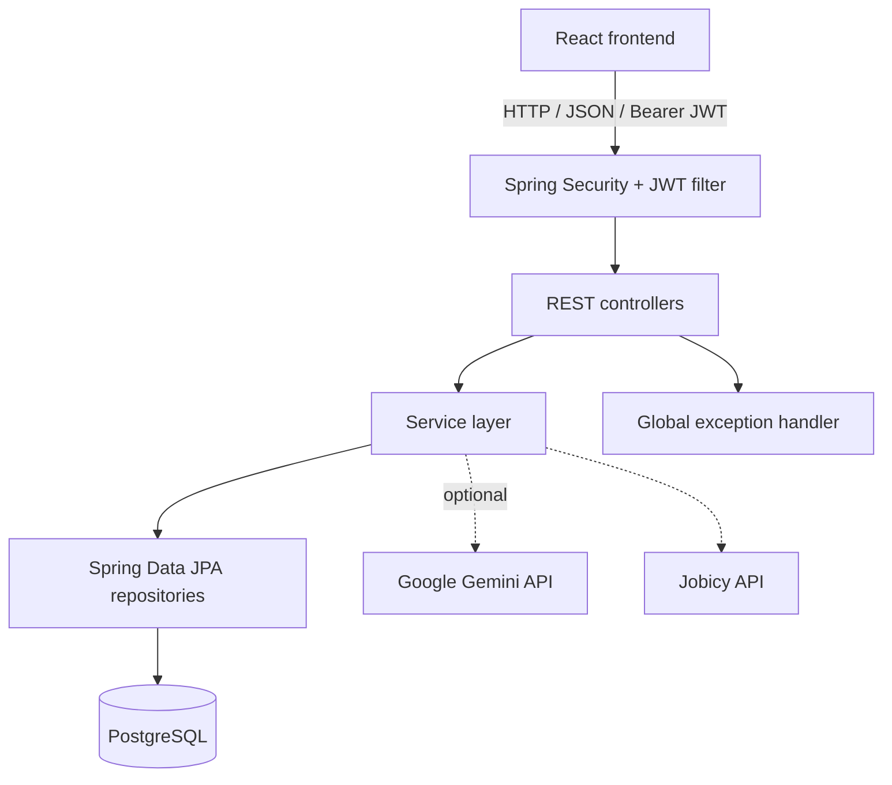
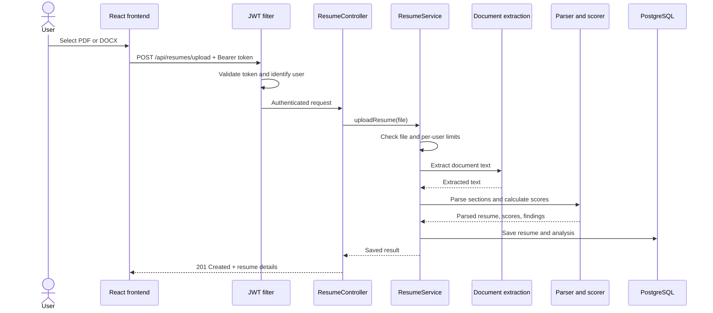
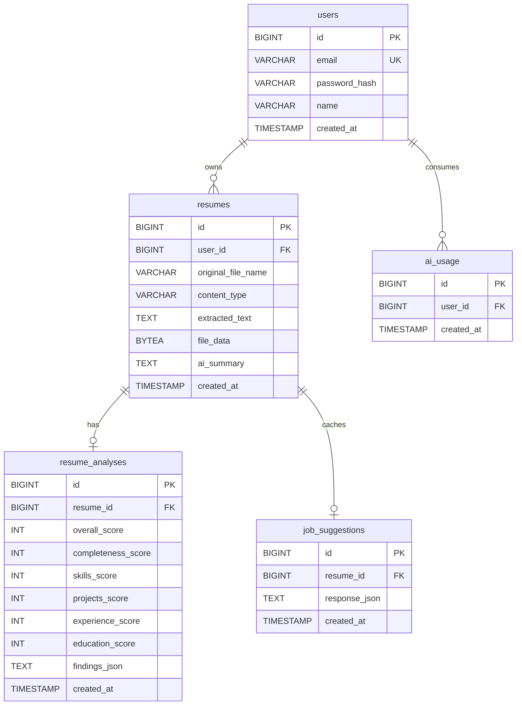

<div align="center">

  <h1>RESQORA</h1>
  <p><strong>Resume analysis. Structured feedback. Better job matching.</strong></p>
  <p>A resume analysis application built with Java, Spring Boot, React, and PostgreSQL.</p>
  <p>
    <a href="https://resqora-1.onrender.com"></a>
    <a href="https://hits.sh/github.com/shalinchristian/Resqora/"></a>
  </p>
</div>

<br/>

> **Resqora** is a resume analysis web application built with **Java, Spring Boot, React, and PostgreSQL**. It extracts content from PDF and DOCX resumes, provides rule-based scoring and feedback, matches resumes against job descriptions, suggests remote jobs, and offers optional AI assistance through Google Gemini.

<details open>
<summary><b>Table of contents</b></summary>

1. [Overview](#1-overview)
2. [Tech stack](#2-tech-stack)
3. [Architecture and data flow](#3-architecture-and-data-flow)
4. [Setup](#4-setup)
5. [Limitations](#5-limitations)

</details>

---

## 1. Overview

### Features

| Feature | What it does |
|---|---|
| **Resume analysis** | Extracts text and organises it into contact information, skills, education, experience, projects, and certifications. |
| **Scoring and findings** | Calculates an overall score and section scores, with findings that point to content that may need improvement. |
| **Job matching** | Compares resume skills with a job description using a local dictionary of approximately 200 skills and aliases. Matching is deterministic and does not use AI. |
| **Job suggestions** | Retrieves remote roles from [Jobicy](https://jobicy.com/api/v2), ranks them by match score, and links to the original listings. |
| **AI assistance (optional)** | Generates a saved resume summary and provides a short resume-focused chat through Gemini. |
| **Account management** | JWT authentication, BCrypt password hashing, account settings, and user-specific resume access. |
| **Document handling** | Uploads, lists, previews, and deletes PDF/DOCX files. Uploads are limited to 2 MB per file and five resumes per user. |
| **API documentation** | Swagger UI with JWT authorization support. |

> Resume scoring and job matching work **without AI**. A Gemini API key is only needed for AI summaries and chat.

---

## 2. Tech stack

| Area | Technologies |
|---|---|
| **Language** |  |
| **Backend** | Spring Boot 4.1.1, Spring Web MVC, Spring Data JPA, Spring Security, Validation |
| **Authentication** | JWT (`jjwt` 0.12.6), BCrypt |
| **Database and migrations** | PostgreSQL, Hibernate/JPA, Flyway (V1–V8) |
| **PDF and DOCX parsing** | Apache PDFBox 3.0.5, Apache POI 5.4.1 |
| **API documentation** | springdoc-openapi 3.1.1, Swagger UI |
| **AI integration** | Google Gemini REST API via Spring `RestClient` |
| **Job search** | Jobicy REST API via Spring `RestClient` |
| **Frontend** | React 19, React Router 7, Vite 6, Tailwind CSS 4, `docx-preview` |
| **Testing** | JUnit 5, Mockito, Spring MockMvc, H2 |
| **Containerisation and build** | Docker multi-stage build, Maven Wrapper, npm |

The repository keeps the backend and frontend separate:

```text
Resqora/
├── resqora-backend/       # Spring Boot API, migrations, tests, Dockerfile
└── resqora-frontend/      # React application
```

---

## 3. Architecture and data flow

### 3.1 System architecture



Controllers handle HTTP requests, services implement application logic, and repositories persist data. DTOs define request and response shapes so JPA entities are not returned directly by the API.

### 3.2 Resume upload flow



The analysis is generated during upload and saved with the resume, allowing the dashboard to display scores immediately.

### 3.3 Database relationships



Each user can own multiple resumes and AI usage records. A resume can have a saved analysis and cached job suggestions. Resume-related records are deleted when their parent resume is deleted, according to the configured foreign-key cascade rules. Flyway migrations define the actual database schema.

---

## 4. Setup

### Prerequisites

- Docker
- Node.js and npm
- A PostgreSQL database
- JDK 21 only if running the backend without Docker

### 4.1 Configure PostgreSQL and backend variables

Create an empty PostgreSQL database, for example `resqora`. Create `resqora-backend/.env` with your own values:

```dotenv
RESQORA_DB_URL=jdbc:postgresql://YOUR_DB_HOST:5432/resqora
RESQORA_DB_USERNAME=YOUR_DB_USERNAME
RESQORA_DB_PASSWORD=YOUR_DB_PASSWORD
RESQORA_JWT_SECRET=REPLACE_WITH_A_SECURE_SECRET_AT_LEAST_32_CHARACTERS_LONG
# Optional: enables Gemini summary and chat
GEMINI_API_KEY=
```

> Use a secure JWT secret of at least 32 characters. Never commit `.env`, database credentials, JWT secrets, or API keys. If PostgreSQL runs on your host while the backend runs in Docker Desktop, `host.docker.internal` can be used as the database hostname. Replace it if your deployment uses a different network setup.

### 4.2 Build and run the backend with Docker

From the repository root:

```bash
cd resqora-backend
docker build -t resqora-backend .
docker run --rm --name resqora-backend --env-file .env -p 8080:8080 resqora-backend
```

The multi-stage Dockerfile builds the application with a Java 21 JDK image and runs the JAR with a Java 21 JRE image. The API listens on port `8080` by default, and Flyway applies database migrations during startup.

<details>
<summary><b>Run without Docker</b></summary>

<br/>

Configure the same environment variables and use the Maven Wrapper:

```bash
cd resqora-backend
./mvnw spring-boot:run
```

On Windows PowerShell, run `.\mvnw.cmd spring-boot:run` from `resqora-backend`.

</details>

### 4.3 Run the frontend

Open another terminal from the repository root:

```bash
cd resqora-frontend
npm install
npm run dev
```

Open [http://localhost:5173](http://localhost:5173). Vite proxies `/api` requests to `http://localhost:8080` during development. The backend's `RESQORA_CORS_ORIGINS` must include the frontend origin when it differs from the default.

For a production frontend build, set `VITE_API_URL` to the backend base URL (without `/api`), then run:

```bash
npm run build
```

Vite writes the static output to `resqora-frontend/dist/`.

### 4.4 API docs and tests

With the backend running, open [Swagger UI](http://localhost:8080/swagger-ui.html). Use **Authorize** to test endpoints that require a JWT.

Run the backend tests:

```bash
cd resqora-backend
./mvnw test
```

On Windows, use `.\mvnw.cmd test`. The tests use H2 and test doubles for external services, so they do not require a real Gemini key or Jobicy API call.

### Configuration

<details>
<summary><b>Environment variables</b></summary>

<br/>

| Variable | Default | Purpose |
|---|---|---|
| `RESQORA_JWT_EXPIRATION_MS` | `3600000` | JWT lifetime (one hour) |
| `RESQORA_CORS_ORIGINS` | `http://localhost:5173` | Allowed frontend origin(s) |
| `PORT` | `8080` | HTTP port |
| `RESQORA_DB_POOL_SIZE` | `3` | Maximum database connection pool size |
| `GEMINI_API_KEY` | Empty | Enables AI summaries and chat |
| `GEMINI_MODEL` | `gemini-3.5-flash-lite` | Gemini model name |
| `RESQORA_AI_USER_DAILY_LIMIT` | `10` | AI calls per user per day |
| `RESQORA_AI_DAILY_CAP` | `50` | AI calls across the app per day |
| `RESQORA_TIMEZONE` | `Asia/Kolkata` | Time zone for daily AI limits |
| `RESQORA_JOBICY_BASE_URL` | `https://jobicy.com/api/v2` | Jobicy API base URL |
| `RESQORA_SWAGGER_ENABLED` | `true` | Enables/disables Swagger UI and API docs |

Login throttling and demo-account options are also configurable through environment variables; see `resqora-backend/src/main/resources/application.properties` for their defaults.

</details>

---

## 5. Limitations

- Scanned or image-only PDFs are rejected with `422 Unprocessable Entity`; OCR is not implemented.
- Parsing uses text patterns and heuristics. Unusual layouts can still be misread.
- Resume analysis runs synchronously during upload, so larger files can take longer to process.
- Job suggestions focus on remote jobs open to the Asia-Pacific region, not all office-based jobs in Indian cities.
- Job results are cached in memory for 30 minutes and per resume for 12 hours; caches are not shared across backend instances.
- JWTs expire after one hour by default. Refresh tokens are not implemented.
- Login throttling is in memory, resets on restart, and is not shared across backend instances.
- AI features send resume text, and any supplied job description or chat context, to Google Gemini. AI is optional; scoring and job matching do not depend on it.

---

<div align="center">
<sub>If Resqora helped you, drop a star on the repo.</sub>

</div>